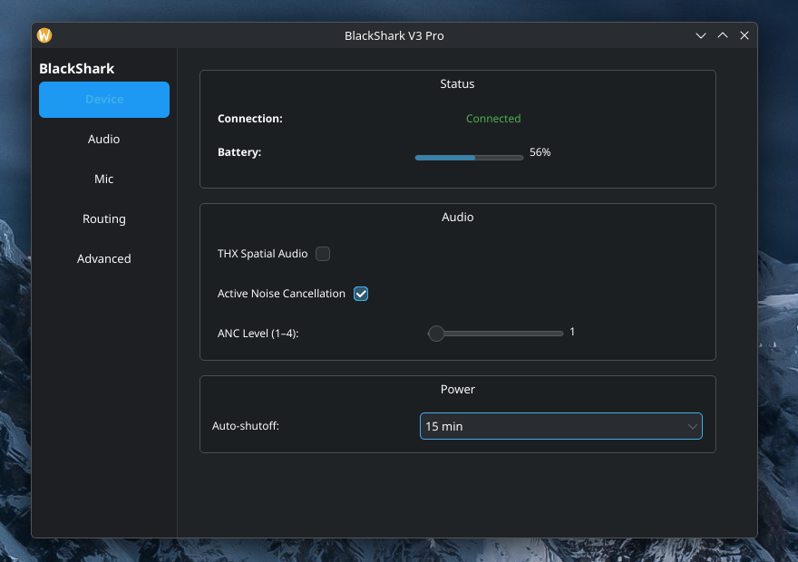
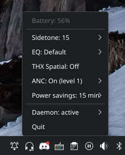

# blackshark-ctl

Linux userspace driver for the **Razer BlackShark V3 Pro** wireless headset (PC and Xbox editions).
Controls sidetone, EQ presets, THX Spatial Audio, ANC and power savings without Razer Synapse or Windows.



## Features

- Sidetone (0–15), EQ presets (9), THX Spatial Audio, ANC (on/off, level 1–4), power-savings timeout
- Battery percentage and charging state
- Settings persist in `~/.config/blackshark/config.toml` and are restored on reconnect
- System tray, settings GUI and a scriptable CLI (`status --json` for waybar)



## Install

Requires Linux with a systemd user session. Tested on Arch/CachyOS (KDE, Wayland).

1. Download the latest tarball from [Releases](https://github.com/RiskRunner0/blackshark-linux/releases).
2. Run:
   ```bash
   tar xzf blackshark-ctl-*.tar.gz && cd blackshark-ctl-*
   ./install.sh
   ```
3. Unplug and re-plug the dongle.

To build from source instead, clone the repo and run `./install.sh` (needs [Rust](https://rustup.rs)).
The script installs binaries to `~/.local/bin`, starts `blacksharkd` as a systemd user service, and
installs the udev rule (needs `sudo`).

**Firmware 1.3.x or later is required** on both the headset and the dongle (update via Synapse on Windows).

To remove everything: `./uninstall.sh` (add `--purge` to also delete your settings).

## Usage

```bash
blackshark-ctl status [--json]
blackshark-ctl battery
blackshark-ctl sidetone <0-15>
blackshark-ctl eq <0-8>                       # 0 = Flat
blackshark-ctl thx <on|off>
blackshark-ctl anc <on|off> [level 1-4]
blackshark-ctl power-savings <0|15|30|45|60>  # minutes
blackshark-ctl monitor                        # stream live changes
```

`blackshark-gui` opens the settings panel (its Advanced tab has daemon controls, a log viewer and the
experimental PipeWire game/chat mix). `blackshark-tray` shows battery and quick toggles; to start it on
login: `install -m644 pkg/blackshark-tray.desktop ~/.config/autostart/`.

## Troubleshooting

`blackshark-ctl status` says "headset is not connected"? Check the daemon log:

```bash
journalctl --user -u blacksharkd -f
```

| Log line | Meaning |
|---|---|
| `cannot open dongle: ... not visible` | Dongle unplugged, or no permission on `/dev/hidraw*`. Replug it after installing. |
| `cannot open dongle: ... no HID interface 5` | Different interface layout on your firmware. Please open an issue. |
| `waiting for headset ...` | Dongle is fine but the headset isn't answering. See below. |
| `headset connected` | Working. |

If it's stuck on "waiting for headset", the dongle isn't linked to the headset (audio can still play,
because the dongle is also a USB sound card). Check that the headset is on, in 2.4GHz mode (green LED,
not white/Bluetooth), and on firmware 1.3.x+. If it lost its pairing, re-pair it with Razer's pairing
tool on Windows ([#7](https://github.com/RiskRunner0/blackshark-linux/issues/7)).

When opening an issue, attach the output of:

```bash
pkg/diagnose.sh > blackshark-diagnostics.txt
```

For protocol-level logs, run the daemon in the foreground:

```bash
systemctl --user stop blacksharkd
RUST_LOG=blacksharkd=debug,blackshark_device=debug blacksharkd
```

## How it works

```
blackshark-ctl / -tray / -gui ──D-Bus (net.blackshark1, session bus)──> blacksharkd ──hidapi──> dongle (USB)
```

`blacksharkd` is the only process that touches `/dev/hidraw*`; everything else talks to it over D-Bus.
Crates live in `crates/` (`protocol`, `device`, `blackshark-client`, `blacksharkd`, and the three front ends).

The udev rule (`pkg/99-blackshark.rules`) matches USB `1532:0577` (PC) and `1532:0a55` (Xbox), tags the
device `uaccess` and grants the `users` group access. The control interface is HID interface 5
(64-byte reports, report ID `0x02`) using Razer's custom protocol.

## License

GPL-3.0-or-later. See [LICENSE](LICENSE).
